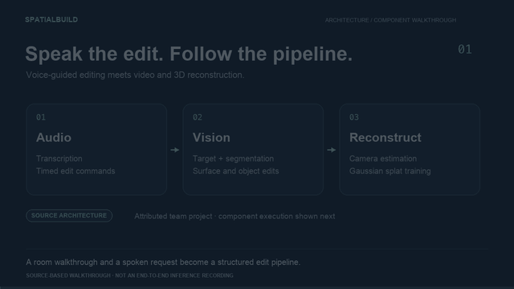
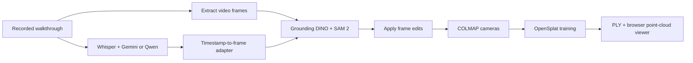

# SpatialBuild

**A narrated room walkthrough, connected to a scene-editing and reconstruction pipeline.**

SpatialBuild combines speech, computer vision, and 3D reconstruction: extract timed edit requests from a recording, apply them to video frames, and reconstruct the edited room with COLMAP and OpenSplat. A request such as “paint this wall green” is anchored to the frame being viewed when it was spoken.

[Setup & run](docs/SETUP.md) · [Demo guide](docs/DEMO.md) · [Source provenance](docs/INTEGRATION.md)

[](docs/assets/spatialbuild-walkthrough.webm)

**[Watch the 32-second walkthrough](docs/assets/spatialbuild-walkthrough.webm)** · [Pipeline diagram](docs/assets/pipeline.svg) · [Demo notes](docs/DEMO.md)

*An architecture/component walkthrough with an executed command-adapter fixture. It explains the pipeline; it is not a recording of end-to-end model inference or reconstruction.*

## What it does

- **Understand a walkthrough:** Whisper transcribes speech; Gemini or a local Qwen model extracts timestamped edit commands.
- **Edit the right region:** Grounding DINO locates the target, SAM 2 segments and tracks it, and specialized editors recolor, retexture, place images, or remove objects with LaMa.
- **Reconstruct the result:** COLMAP estimates cameras; OpenSplat trains a Gaussian splat from the edited frames.
- **Inspect the output:** generate a browser viewer, with optional Tripo3D furniture meshes. The bundled viewer renders the PLY as a **point cloud**, rather than a full Gaussian splat renderer.

## Start here

| Goal | Path |
| --- | --- |
| Check the source without model downloads | Run the regression checks below. |
| Process your own recording | Follow [Setup & run](docs/SETUP.md). Requires model downloads and a suitable GPU environment. |
| Reconstruct a known dataset | Use reconstruction's `--test` mode after installing COLMAP and OpenSplat; it downloads the banana dataset. |

### Run the regression checks

Use Python 3.10 or later:

```bash
git clone https://github.com/sudhanvad18/SpatialBuild.git
cd SpatialBuild
python3 -m venv .venv
source .venv/bin/activate
python -m pip install -r reconstruction_pipeline/requirements.txt
python -m unittest discover -s tests -v
```

These eight checks cover checkout-relative paths, OpenSplat discovery, dataset extraction, and isolated test workspaces. They mock downloads and external execution; no API keys or training are required.

## How it works

The handoff between stages is explicit: timestamped audio commands become frame-indexed commands; edited JPEGs become the reconstruction input. Frame extraction and timestamp conversion must use the same frame rate. The current video configuration is 30 fps.



The vision router accepts `recolor`, `retexture`, `remove`, and `place_image`. General furniture `add` requests use reconstruction's optional `--commands` path. Optional ElevenLabs confirmations and Gemini reports are separate from the core editing path.

## Project layout

```text
audio_pipeline/           Recording conversion, transcription, command extraction
vision_pipeline/src/     Command adapter, grounding, segmentation, frame editors
reconstruction_pipeline/ COLMAP orchestration, splat training, viewer generation
tests/                   Reconciliation regression checks
docs/                    Setup, demonstration guide, and source provenance
```

## Verification and scope

The regression suite covers integration behavior with mocked external tools. Full model inference and reconstruction require the model weights and native tools in the [setup guide](docs/SETUP.md). This repository provides pipeline source and tests; model checkpoints and a separately hosted frontend are not bundled. See the [demo guide](docs/DEMO.md) for the artifacts needed to demonstrate a complete run.

## Credits

This public source snapshot combines the team project from [archakamk/SpatialBuild](https://github.com/archakamk/SpatialBuild) with Sudhanva Deshpande's local audio and reconstruction work. It preserves the local Qwen extraction backend and reconciles reconstruction behavior with the team implementation. [Integration notes](docs/INTEGRATION.md) record source revisions and the decisions made when combining them.
